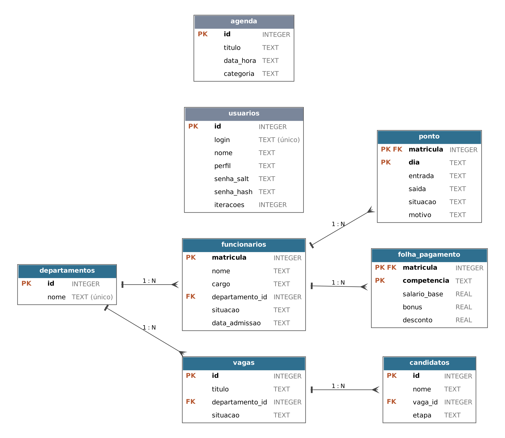

# Banco de dados do Aurora

**Parte do trabalho:** modelar as tabelas e os relacionamentos, fazer os scripts de criação e de dados fictícios e programar a camada de acesso aos dados.

---

## O que tem nesta pasta

| Arquivo | Pra que serve |
| --- | --- |
| `01_criar_tabelas.sql` | Cria as 8 tabelas, as chaves e os índices |
| `02_dados_ficticios.sql` | Coloca dados inventados pra testar e apresentar |
| `03_consultas_uteis.sql` | Alguns SELECTs com JOIN pra conferir os dados |
| `diagrama_ER.png` | Desenho das tabelas e de como elas se ligam |
| `aurora_exemplo.db` | O banco já pronto, com os dados, pra abrir direto no DB Browser |

O código C# que conversa com o banco fica na pasta `Aurora.Dados` (explico mais embaixo).

---

## Por que escolhi o SQLite

O SQLite guarda o banco inteiro num arquivo só (`aurora.db`). Ninguém do grupo precisa instalar MySQL ou SQL Server pra rodar o projeto, e o professor também não. É só abrir no Visual Studio e dar F5.

Pra ver as tabelas por fora do sistema, usei o **DB Browser for SQLite** (é de graça). Abre o `aurora_exemplo.db` nele e vai na aba "Navegar dados".

---

## As tabelas



| Tabela | O que guarda | Chave |
| --- | --- | --- |
| `usuarios` | Contas do login (admin, rh, gestor) | `id` |
| `departamentos` | Pessoas, Tecnologia, Financeiro, Comercial, Operações | `id` |
| `funcionarios` | Cadastro dos funcionários | `matricula` |
| `ponto` | Entrada, saída, falta e atraso de cada dia | `matricula` + `dia` |
| `folha_pagamento` | Salário, bônus e desconto de cada mês | `matricula` + `competencia` |
| `vagas` | Vagas do recrutamento | `id` |
| `candidatos` | Quem está concorrendo a cada vaga | `id` |
| `agenda` | Compromissos do RH | `id` |

### Os relacionamentos

Todos são **1 pra N** (um pra muitos):

- **departamentos → funcionarios**: um departamento tem vários funcionários.
- **departamentos → vagas**: um departamento pode abrir várias vagas.
- **funcionarios → ponto**: um funcionário tem um ponto por dia, então vários no total.
- **funcionarios → folha_pagamento**: um funcionário tem uma folha por mês.
- **vagas → candidatos**: uma vaga pode ter vários candidatos.

`usuarios` e `agenda` ficaram sem ligação com as outras tabelas. Elas não precisavam.

### Algumas decisões que tomei

- **Departamento numa tabela separada.** Assim o nome do setor não fica repetido em todo funcionário e em toda vaga, e não tem risco de alguém digitar "Tecnologia" num lugar e "tecnologia" em outro.
- **Ponto com chave dupla (matrícula + dia).** O próprio banco impede de bater dois pontos no mesmo dia pra mesma pessoa.
- **Folha com chave dupla (matrícula + competência).** A competência é sempre o dia 1 do mês (novembro = `2026-11-01`). Se salvar de novo o mesmo mês, substitui em vez de duplicar.
- **Não guardei o salário líquido.** Ele é só `salario_base + bonus - desconto`, então calculo na hora.
- **ON DELETE RESTRICT.** O banco não deixa apagar um funcionário que já tem ponto ou folha, pra não perder o histórico. Nesse caso o certo é mudar a situação pra "Inativo".
- **CHECK nas situações.** Situação, etapa, perfil e categoria só aceitam os valores que existem na tela. Se tentar gravar "Demitido", por exemplo, o banco recusa.
- **Datas como texto** (`AAAA-MM-DD`). O SQLite não tem um tipo de data próprio, e nesse formato a ordem alfabética já fica igual à ordem das datas.

---

## Dados fictícios

Tudo inventado. Usei os mesmos nomes que já apareciam na demonstração do sistema, pra tela não mudar:

- 3 usuários (`admin`, `rh`, `gestor`). A senha é `Aurora.demo26`.
- 5 departamentos
- 8 funcionários (matrículas 101 a 108)
- 30 registros de ponto (semana de 09/11 a 13/11/2026)
- 12 lançamentos de folha (outubro e novembro de 2026)
- 3 vagas e 4 candidatos
- 3 compromissos na agenda

---

## A camada de acesso aos dados (pasta `Aurora.Dados`)

| Arquivo | O que faz |
| --- | --- |
| `Conexao.cs` | Abre a conexão com o banco e liga as chaves estrangeiras |
| `CriadorDoBanco.cs` | Na primeira vez que o sistema abre, cria o `aurora.db` rodando os scripts 01 e 02 |
| `RepositorioSqlite.cs` | Faz os SELECT, INSERT, UPDATE e DELETE de funcionários, ponto, folha, vagas, candidatos e agenda |
| `ContasDoBanco.cs` | Procura o usuário na tabela `usuarios` na hora do login |

As interfaces `IRhRepository` e `IAccountDirectory` já existiam no projeto. A camada de dados só implementa essas interfaces usando o banco, por isso as telas não mudaram nada. No `Program.cs`, a lista em memória (`DemoRh`) foi trocada pelo `RepositorioSqlite`.

Alguns cuidados no código:

- **Uso parâmetros** (`$nome`, `$cargo`...) em vez de montar o SQL juntando texto. Assim um nome como "D'Ávila" não quebra o comando, e fica protegido contra SQL Injection.
- **Erro do banco vira mensagem amigável.** Se uma chave ou um CHECK barrar a gravação, o usuário vê uma mensagem normal na tela, em vez de um erro técnico do SQLite.
- **Cada operação abre e fecha a conexão** com `using`, pra não deixar o arquivo preso.

---

## Como rodar

1. Abrir o `Aurora.slnx` no Visual Studio (precisa do .NET 10).
2. Na primeira vez, o Visual Studio baixa sozinho o pacote `Microsoft.Data.Sqlite` (precisa de internet).
3. Dar F5. O sistema cria o `aurora.db` do lado do `.exe` e já entra com os dados fictícios.
4. **Pra voltar os dados ao começo:** fecha o sistema e apaga o `aurora.db` da pasta `bin`. Na próxima vez ele cria de novo.

Os testes do banco estão em `Aurora.Tests/TesteDoBanco.cs` e rodam junto com os testes do grupo:

```
dotnet run --project Aurora.Tests -c Release
```

---

## Limitações

- O SQLite é ótimo pra um projeto como o nosso, mas não é o ideal pra muita gente usando ao mesmo tempo em rede. Se um dia precisar, dá pra trocar por SQL Server ou MySQL mudando só a pasta `Aurora.Dados`.
- O valor em dinheiro está como `REAL`. Pra valores de salário funciona bem, porque arredondo pra 2 casas na leitura, mas num sistema de banco de verdade o certo seria guardar em centavos.
