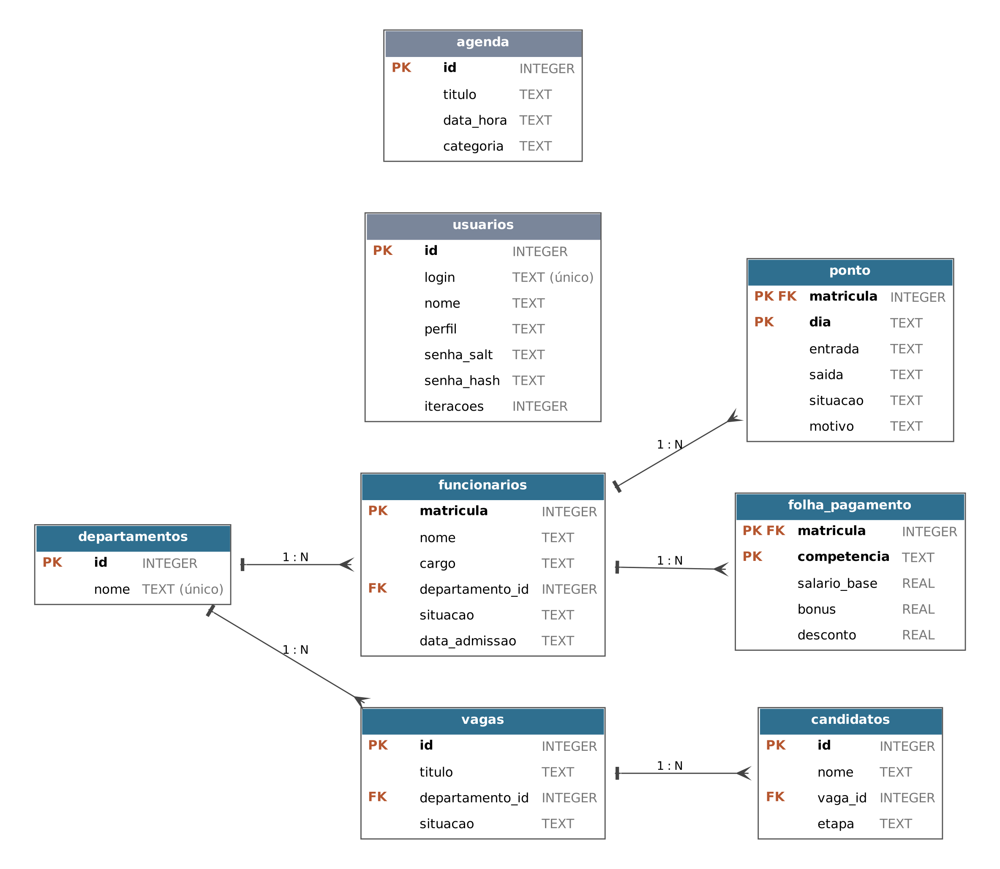

# Relatório do Projeto · Gestão de RH

**Disciplina:** Programação Orientada a Objetos
**Professor:** Marcos Gomes da Silva Rocha
**Instituição:** UniFacema · Centro Universitário de Ciências e Tecnologia do Maranhão
**Equipe:** Alberto, Rickelmy, Paulo Victor, Jefferson, Clóvis, Kerlon e Cleberson Dias
**Data:** novembro de 2026

---

## 1. Apresentação

O Gestão de RH (projeto Aurora) é um sistema desktop para o setor de Recursos Humanos de uma empresa fictícia. Ele reúne em um só lugar o cadastro de funcionários, o controle de ponto, o recrutamento, a agenda do RH e a folha de pagamento.

O sistema foi feito em **C# com .NET 10 e Windows Forms**, com os dados guardados em um banco **SQLite**. Cada integrante ficou com uma área. As partes foram juntadas em uma só solução no GitHub e testadas em conjunto.

O que o sistema faz:

- login com três perfis: Administrador, Recursos Humanos e Gestor;
- cadastro de funcionários, com ficha do funcionário, inativação e sugestão de cargos;
- controle de ponto (presença, atraso e falta), com lançamento de falta e de atraso e consulta por período;
- recrutamento, com vagas, candidatos, funil de etapas, avançar etapa e mudar de vaga;
- agenda do RH;
- folha de pagamento, com edição de lançamento;
- painel com o resumo do dia;


## 2. Organização da solução

A solução `Aurora.slnx` é dividida em quatro projetos, cada um com uma função:

| Projeto | Função |
| --- | --- |
| `Aurora.WinForms` | Telas do sistema (login, painel, funcionários, ponto, recrutamento, agenda e salários) |
| `Aurora.Core` | Modelos, regras de negócio (`ServicoRh`), login (`Autenticacao`) e as extensões de cada parte |
| `Aurora.Dados` | Camada de acesso ao banco SQLite |
| `Aurora.Tests` | Testes das regras de cada parte, em memória e no banco, e testes das telas |

O caminho de uma operação, da tela até o banco, é sempre o mesmo:

```
Tela (Aurora.WinForms)
  -> ServicoRh e extensões (Aurora.Core): sessão, perfil e validações
    -> IRepositorio
      -> RepositorioSqlite (Aurora.Dados) -> aurora.db
```

Como todas as partes passam pelo `ServicoRh`, as regras de permissão valem para o sistema inteiro: o Gestor consulta, mas não grava nada, mesmo que tente.

## 3. Divisão da equipe

| Integrante | Parte |
| --- | --- |
| Rickelmy | Interface e back-end: telas, login, permissões e regras |
| Alberto | Banco de dados: tabelas, scripts SQL, dados fictícios e camada de acesso aos dados |
| Jefferson | Cadastro de funcionários: ficha, inativar e sugestão de cargos |
| Clóvis | Ponto e frequência: lançar falta e atraso, consulta por período |
| Kerlon | Recrutamento: funil de etapas, candidatos da vaga, avançar etapa e mudar de vaga |
| Cleberson Dias | Salários: edição de lançamento da folha e testes da folha |
| Paulo Victor | Interface |

## 4. O que cada integrante fez

### 4.1 Rickelmy · Interface e back-end

- Montou as telas do sistema: login, painel e o menu lateral com todas as áreas, no visual escuro do Aurora.
- Criou o login por usuário e senha. A senha é guardada como hash PBKDF2 com SHA-256 e salt por conta, nunca aberta.
- Centralizou as permissões no `ServicoRh`. Administrador e RH alteram os registros; o Gestor só consulta e não vê salários.
- Levou as validações para o serviço: impede excluir funcionário com histórico, confere horários e ponto duplicado, bloqueia inscrição em vaga encerrada e valida os valores da folha.
- Deixou prontas as interfaces `IRepositorio` e `IBuscaDeContas`, que permitiram ligar o banco sem mudar as telas.
- Fez o primeiro conjunto de testes (`ProgramaDeTestes.cs`), que abre as telas e clica nos botões.

Segundo o relatório dele, a parte de interface, que na divisão da equipe era do Paulo Victor, foi concluída por ele junto com o back-end.

Arquivos principais: `Aurora.Core/ServicoRh.cs`, `Autenticacao.cs`, `Modelos.cs`, `IRepositorio.cs`, `Aurora.WinForms/TelaPrincipal.cs`, `TelaPrincipal.Modulos.cs`, `Estilo.cs`, `TelaDeLogin.cs` e `JanelaDeCadastro.cs`.

### 4.2 Alberto · Banco de dados

- Modelou 8 tabelas no SQLite: `usuarios`, `departamentos`, `funcionarios`, `ponto`, `folha_pagamento`, `vagas`, `candidatos` e `agenda`.
- Escreveu o script de criação, com chaves primárias, chaves estrangeiras, CHECK e índices, e o script de dados fictícios com os mesmos funcionários e vagas da demonstração.
- Escreveu um script de consultas de exemplo com JOIN.
- Criou o projeto `Aurora.Dados`, que implementa `IRepositorio` e `IBuscaDeContas` usando o banco. Os valores vão sempre por parâmetro, o que protege contra SQL Injection.
- Ligou o banco no `Program.cs`: o arquivo `aurora.db` é criado sozinho na primeira execução, e o que é cadastrado continua salvo depois de fechar o sistema.
- Fez os testes do banco, que repetem em cima do SQLite os mesmos casos testados em memória.
- Juntou as partes da equipe no repositório e deixou os testes de todas as partes rodando juntos.

Arquivos principais: pasta `BancoDeDados` (scripts 01, 02 e 03, diagrama e banco de exemplo), pasta `Aurora.Dados` e `Aurora.Tests/TesteDoBanco.cs`.

### 4.3 Jefferson · Cadastro de funcionários

- Acrescentou a coluna Matrícula na tabela de funcionários.
- Criou o botão **Consultar ficha**, que mostra cadastro, tempo de casa, ponto do mês e último salário. O salário só aparece para Administrador e RH.
- Criou o botão **Inativar**, para quem tem histórico e por isso não pode ser excluído.
- Fez o campo Cargo sugerir os cargos que já existem, para evitar o mesmo cargo escrito de jeitos diferentes.
- Escreveu as consultas SQL do cadastro e os testes da parte dele, em memória e no banco.

Arquivos principais: `Aurora.Core/CadastroDeFuncionarios.cs`, `Aurora.WinForms/TelaPrincipal.Funcionarios.cs`, `JanelaDaFicha.cs`, `BancoDeDados/04_consultas_funcionarios.sql` e `Aurora.Tests/TesteDosFuncionarios.cs`.


### 4.4 Clóvis · Ponto e frequência

- Criou os botões **Lançar falta** e **Lançar atraso**. O atraso só é aceito com entrada depois das 08:00, o horário padrão.
- Criou a janela **Consultar período**, com a frequência de qualquer intervalo de até 366 dias, filtros por funcionário e ocorrência, totais do período e totais de cada funcionário.
- Escreveu as consultas SQL do ponto e 31 testes da parte dele.

Arquivos principais: `Aurora.Core/FrequenciaDePonto.cs`, `Aurora.WinForms/TelaPrincipal.Ponto.cs`, `JanelaDeFrequencia.cs`, `BancoDeDados/05_consultas_ponto.sql` e `Aurora.Tests/TesteDoPonto.cs`.


### 4.5 Kerlon · Recrutamento

- Criou o **funil de etapas**, que mostra quantos candidatos há em Triagem, Entrevista, Teste técnico, Proposta e Contratado.
- Criou o botão **Candidatos da vaga**, que filtra as candidaturas pela vaga escolhida.
- Criou **Avançar etapa**, que leva a candidatura para a etapa seguinte, e **Mudar de vaga**, que passa a candidatura para outra vaga aberta sem perder a etapa.
- Impediu que o mesmo nome se inscreva duas vezes na mesma vaga.

Arquivos principais: `Aurora.Core/Recrutamento.cs` e `Aurora.WinForms/TelaPrincipal.Recrutamento.cs`. Os testes da parte dele estão em `Aurora.Tests/TesteDoRecrutamento.cs`.


### 4.6 Cleberson Dias · Salários

- Criou o botão **Editar lançamento** na folha de pagamento. Antes, para corrigir um valor, era preciso digitar o lançamento inteiro de novo.
- Na edição, funcionário e competência ficam travados, porque são a chave do lançamento; só salário, bônus e descontos mudam. O duplo clique na linha também abre a edição.
- Escreveu os testes da folha, que rodam os mesmos casos na lista em memória e no banco SQLite e conferem que os lançamentos continuam salvos depois de reabrir o banco.

Arquivos principais: `Aurora.WinForms/TelaPrincipal.Modulos.cs` (tela de Salários) e `Aurora.Tests/TesteSalarios.cs`. No código, os comentários dele estão marcados com `Diaz:`.


### 4.7 Paulo Victor · Interface

Na divisão da equipe, Paulo Victor ficou com a interface. Até a data deste relatório, não há arquivos dele no repositório. As telas do sistema foram concluídas por Rickelmy (item 4.1).

## 5. Banco de dados

O banco fica em um único arquivo (`aurora.db`), sem precisar instalar servidor. Ele é criado na primeira execução pelos scripts da pasta `BancoDeDados`.



| Tabela | O que guarda |
| --- | --- |
| `usuarios` | Contas de login, com perfil, salt e hash da senha |
| `departamentos` | Departamentos da empresa |
| `funcionarios` | Cadastro dos funcionários (a matrícula é a chave) |
| `ponto` | Um registro por funcionário por dia: presença, atraso ou falta |
| `folha_pagamento` | Um lançamento por funcionário por mês: salário, bônus e descontos |
| `vagas` | Vagas abertas e encerradas |
| `candidatos` | Candidaturas, com a vaga e a etapa do processo |
| `agenda` | Compromissos do RH |

Regras garantidas pelo próprio banco:

- chave dupla (matrícula + dia) no ponto e (matrícula + competência) na folha, para não haver registro repetido;
- `ON DELETE RESTRICT`: um funcionário com ponto ou folha não pode ser apagado, para o histórico não sumir;
- `CHECK` nas situações, etapas e valores, para o banco recusar dados inválidos mesmo que a tela deixe passar.

Dados fictícios: 8 funcionários, 30 registros de ponto e 12 lançamentos de folha, com data de referência 13/11/2026.

## 6. Programação Orientada a Objetos no projeto

| Conceito | Onde aparece |
| --- | --- |
| Classes | Cada parte é uma classe com uma função só: `ServicoRh` cuida das regras, `RepositorioSqlite` do banco, `TelaDeLogin` da tela de entrada |
| Herança | As telas herdam do Windows Forms: `TelaDeLogin : Form`, `JanelaDaFicha : Form` |
| Encapsulamento | As listas ficam privadas dentro do repositório; a tela só fala com o serviço, nunca direto com os dados |
| Polimorfismo | `DadosDeExemplo` (memória) e `RepositorioSqlite` (banco) implementam a mesma interface `IRepositorio`, e as telas funcionam com qualquer um dos dois |
| Interfaces | `IRepositorio` e `IBuscaDeContas` separam as regras da forma de guardar os dados |
| Métodos de extensão | Jefferson, Clóvis e Kerlon acrescentaram funções ao `ServicoRh` em arquivos próprios, sem mudar o serviço original |

## 7. Testes

O projeto `Aurora.Tests` roda as regras de cada parte duas vezes: uma com a lista em memória e outra com um banco SQLite temporário, que não mexe no `aurora.db` do sistema. Depois abre as telas e clica nos botões, como um usuário faria.

| Arquivo | Parte testada |
| --- | --- |
| `TesteDoBanco.cs` | Banco de dados: login, permissões, ponto, folha, vagas, candidatos, funcionários e agenda no SQLite |
| `TesteDoPonto.cs` | Ponto e frequência (31 testes) |
| `TesteSalarios.cs` | Folha de pagamento, em memória e no banco |
| `TesteDosFuncionarios.cs` | Ficha, cargos, inativar e tempo de casa |
| `TesteDoRecrutamento.cs` | Funil, nome repetido, avançar etapa, mudar de vaga e permissões |
| `ProgramaDeTestes.cs` | Fluxo das telas: login, cadastro, ponto, recrutamento, agenda e salários |

Resultado da última execução das regras: todas as partes aprovadas (banco, ponto, salários, funcionários e recrutamento).

## 8. Código

O código do projeto está no GitHub: https://github.com/albertocx53-code/Gest-oRH-Pie

Os nomes de classes, métodos e variáveis estão em português, e os comentários explicam cada parte com palavras simples. Os comentários de cada integrante começam com o nome dele (por exemplo `Jefferson:` ou `Kerlon:`), para facilitar a busca com Ctrl+Shift+F no Visual Studio.

## 9. Como executar

1. Instalar o Visual Studio com a carga de trabalho **Desenvolvimento para desktop com .NET** (.NET 10).
2. Abrir o arquivo `Aurora.slnx`. Na primeira vez, o Visual Studio baixa o pacote `Microsoft.Data.Sqlite`.
3. Conferir se `Aurora.WinForms` está como projeto de inicialização e apertar **F5**.
4. Entrar com o usuário `admin`, `rh` ou `gestor` e a senha `Aurora.demo26`.

Para rodar os testes, definir `Aurora.Tests` como projeto de inicialização e apertar F5. No fim aparece "Serviços e fluxos do Windows Forms aprovados."

## 10. Limitações e próximos passos

- As contas e os dados são fictícios, feitos para a demonstração.
- A data de "hoje" é fixa em 13/11/2026, para os exemplos sempre mostrarem a mesma situação.
- O valor líquido da folha é uma simulação: salário mais bônus menos descontos, sem impostos.
- A repetição de candidato é conferida só pelo nome; dois homônimos reais seriam bloqueados na mesma vaga.
- Próximos passos possíveis: cálculo de impostos na folha, histórico de mudanças de etapa no recrutamento e busca de funcionário pela matrícula.
